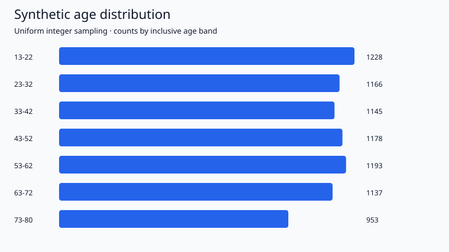

# Age distribution simulator

Generate a synthetic population, summarize ages and export a presentation-ready SVG chart using only Python's standard library.

## Features

- Reproducible uniform integer sampling with configurable size, seed and age limits.
- Exact-age frequencies and inclusive age bands with observed and expected counts.
- Mean, median, population standard deviation and theoretical mean.
- CSV, JSON and accessible SVG outputs.
- Six automated tests covering boundaries, totals, known examples and chart structure.

## Quick start

Requires Python 3.10 or newer. No packages need to be installed. Run from this directory:

```bash
python run.py
python -m unittest -v
python run.py --size 1000 --minimum 18 --maximum 65 --width 5 --seed 42 --output results/custom
```

## Included results

The default simulation generates 8,000 ages from 13 through 80 inclusive, using seed 123. Its mean is 46.354375 years, median is 46 and population standard deviation is 19.744405 years. The theoretical uniform-distribution mean is 46.5 years.



These are synthetic observations for demonstrating a data workflow. They do not describe the demographics of an actual social media platform or population. The final band contains eight possible ages, while preceding bands contain ten; its expected count is correspondingly lower.

## Outputs

| File | Purpose |
| --- | --- |
| `results/age_frequencies.csv` | Count and proportion for each possible age |
| `results/age_bands.csv` | Band counts, proportions and expected counts |
| `results/summary.json` | Descriptive statistics and generation settings |
| `results/age_distribution.svg` | Scalable chart |
| `results/verification.txt` | Automated verification results |

See [METHODS.md](METHODS.md) for assumptions and formulas.
