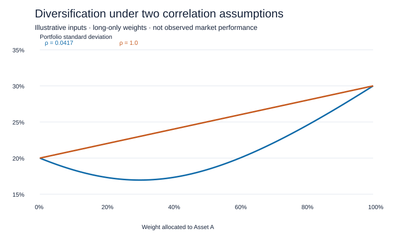

# Two-Asset Diversification Analysis

A small, reproducible analytical project exploring how correlation changes portfolio volatility and the long-only minimum-variance allocation. Adapted from the two-asset section of Derrick Achanga's Posit Cloud `bios/main.qmd` export. This is an educational calculation using assumed inputs, not a historical backtest or investment recommendation.



## Question and inputs

How does changing correlation from 0.0417 to 1 affect diversification?

| Assumed input | Asset A | Asset B |
|---|---:|---:|
| Expected return | 12% | 10% |
| Standard deviation | 30% | 20% |

Both assets use the same unspecified return horizon. Weights sum to one and lie between zero and one. The original exercise used stock names; generic labels avoid suggesting that the assumed inputs are measured company statistics.

## Results

| Correlation | Continuous minimum weight in A | Expected return | Standard deviation |
|---|---:|---:|---:|
| 0.0417 | 29.999360% | 10.599987% | 16.956073% |
| 1.0 | 0% | 10% | 20% |

At low correlation, combining the assets produces lower volatility than either asset alone. At perfect positive correlation, volatility is a weighted average of the two individual volatilities; the long-only minimum is entirely in Asset B. The 10-percentage-point grid gives a weight of 30% in A for the first case; this is a rounded approximation to the continuous solution, not exactly the same optimum.

## Reproduce

Python 3, standard library only:

```sh
python analysis.py
```

The script writes a 22-row CSV, an SVG chart, and a validation log into `results/`, relative to its own location. Checks cover endpoints, the perfect-correlation identity, the boundary optimum, and comparison of the analytical minimum against 10,001 feasible weights per scenario.

A base R counterpart is also provided:

```sh
Rscript analysis.R
```

Run the R command from this project directory. It writes `results/portfolio_grid_R.csv`. **The Python implementation was executed and its checks passed; the R counterpart was reviewed but not executed in the preparation environment.** Committed outputs were generated by Python.

## Method

For weight w in A, mean = w μA + (1−w) μB. Variance = w² σA² + (1−w)² σB² + 2w(1−w)ρσAσB. The unconstrained minimum weight is (σB²−ρσAσB)/(σA²+σB²−2ρσAσB), clipped to [0,1] for the long-only constraint. If the denominator is zero, all feasible allocations have equal variance and the implementation selects zero.

## Scope and provenance

The source export contained malformed Quarto formatting and additional market-data/model sections. Only the self-contained two-asset exercise is included here. The source's cached R workspace and unrelated assignment prose are excluded. No private observations, external downloads, or credentials are required. No results for the other source sections are claimed.

AI assistance was used to restructure this exercise, implement a Python reproduction, prepare the chart and README, and check the arithmetic. This demonstrates a reviewed analytical workflow rather than an independently authored production investment system. Assumed means, volatilities and correlations are fixed; transaction costs, estimation uncertainty and changing market conditions are outside scope.

## Regression tests

From this project directory, run `python -m unittest -v test_analysis.py`.

On 17 October 2026, all six tests passed. They cover risk cancellation at perfect negative correlation, variance addition at zero correlation, the perfect-positive-correlation boundary, numerical minimum checks across seven correlations, invalid weights, and invalid correlations. The minimum-weight function now rejects out-of-range and non-finite correlations consistently with the portfolio function. This update retains the original assumed inputs and outputs.
