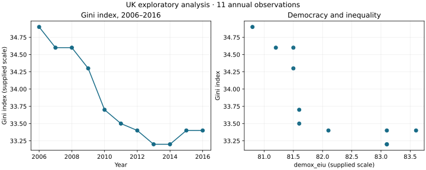

# UK Income Inequality Exploratory Analysis

An R analysis of how the supplied UK Gini index varies alongside democracy, income per person, investment and tax indicators over 2006–2016.

**Author:** Derrick Achanga · **Original analysis:** February 2023 · **Portfolio preparation:** October 2026

This is an exploratory statistical case study, not a causal evaluation or a household-level inequality estimate. The original project was developed in Posit Cloud. Code organisation, documentation and independent numerical verification were assisted by AI during portfolio preparation.



## Question and workflow

How does recorded income inequality vary over time, and how is it associated with the four economic and institutional indicators in this small sample?

1. Validate column names, types, completeness and unique years.
2. Summarise the variables and inspect correlations and plots.
3. Fit an illustrative multiple linear regression.
4. Save coefficients, visualisations and reproducibility information.

Skills demonstrated: R, Excel ingestion, data validation, descriptive statistics, visualisation, multiple regression and critical interpretation.

## Findings

The workbook contains 11 annual UK observations. Mean Gini index is approximately 33.84, with a range of 33.2–34.9. The four-predictor OLS model has R² = 0.8917 and adjusted R² = 0.8195. Its democracy-indicator coefficient is approximately −0.9247, conditional on the other included variables. This is a sample association, not evidence that a change in democracy causes inequality to fall.

The high R² is not evidence of out-of-sample predictive performance. With only six residual degrees of freedom, estimates are fragile. Common time trends, serial correlation, omitted variables and correlated predictors can undermine conventional OLS inference. No policy recommendation is justified by this model alone.

## Files

| Path | Purpose |
|---|---|
| `R/analysis.R` | R workflow with validation and saved outputs |
| `results/` | Descriptive tables and overview figure |
| `verification/verify.py` | Python numerical cross-check against the archived R report |
| `docs/methodology.md` | Methodology, limitations and data dictionary |
| `data/README.md` | Input requirements and data-access limitation |

## Run the R workflow

Install R and the `readxl` package, then run from this directory:

```r
install.packages('readxl')
```

```sh
Rscript R/analysis.R /path/to/your/UK-dataset.xlsx
```

New R outputs are written to `results/r-run/`, separate from the checked-in Python verification outputs.

## Verification

All five independently recalculated OLS coefficients agree with the archived February 2023 R report within 0.0000005. See [validation log](results/validation.txt). The R workflow has not been executed in the verification environment; the committed outputs come from the Python numerical check.

To reproduce the independent check with access to the original workbook:

```sh
python -m pip install numpy scipy pandas openpyxl matplotlib
python verification/verify.py /path/to/your/UK-dataset.xlsx
```

## Data provenance and limitations

The original workbook is not included. Its upstream provider, units, transformations and redistribution terms were not documented in the archived project. Variable names suggest meanings but are not a substitute for a source codebook. Findings describe the supplied workbook and have not been independently validated as official UK statistics. Reproduction requires lawful access to the original input. Do not substitute a different dataset and expect identical estimates.

A useful next step is rebuilding the study from documented public sources over a longer period, then checking time-series assumptions and model stability. This repository does not claim that work has been completed.
